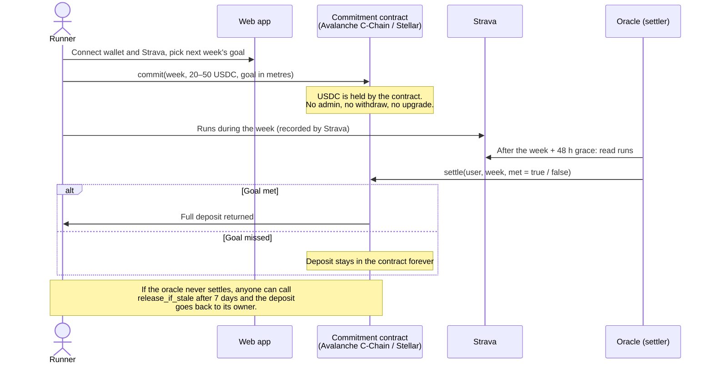
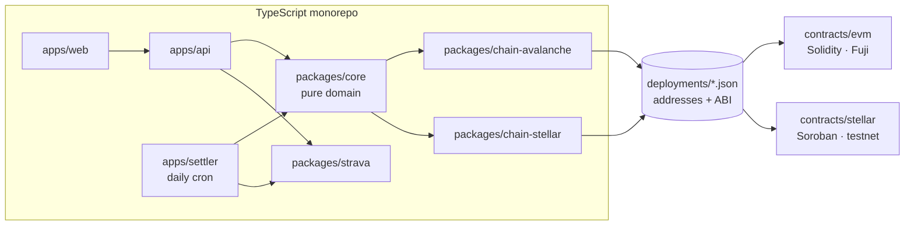

# AgentHabit

Put money on your running goal. You lock 20–50 USDC in a contract and set a weekly distance
goal; Strava verifies your runs. Hit the goal and you get everything back. Miss it and the money
stays locked in the contract forever: nobody collects it, not the platform and not other users.

- **Two chains, same behaviour:** Stellar (Soroban) and Avalanche (Solidity), one adapter per
  chain over a shared domain core.
- **No custody:** the contracts have no admin, no withdrawal and no upgrade.
- **The verifier's failure never costs the user:** if the oracle does not settle in time, anyone
  can return the deposit to its owner.
- **Testnet only** (Stellar testnet and Avalanche Fuji) until Phase 2.

Status: Phase 1 (MVP on testnet); Phase 0 closed at `v0.0.1`. See [ROADMAP.md](ROADMAP.md).
Project docs are in Spanish under [docs/](docs/).

**Hackathon:** submitted to the Vinny hackathon (Avalanche). The submission checklist is in
[docs/HACKATON-VINNY.md](docs/HACKATON-VINNY.md) (Spanish).

## The problem

Most people who set a running goal drop it within weeks. Commitment devices with money at stake
work, but the existing ones either keep the money (a fee or a "charity" the platform picks) or
pool it and pay it to the people who succeeded, which turns a habit into a bet and gives the
operator a reason to want you to fail.

AgentHabit removes the operator from the money. The stake sits in a contract nobody controls,
the only possible outcomes are "back to you" or "locked forever", and the rules are public code.

## How it works



The contract exposes only three functions that move funds:

| Function | Who can call it | What it does |
|---|---|---|
| `commit(user, week_id, amount, goal_m)` | the user | Locks 20–50 USDC for **next** week; one position per user and week |
| `settle(user, week_id, met)` | the oracle, inside its window | `met` returns the deposit; otherwise it is forfeited and stays in the contract |
| `release_if_stale(user, week_id)` | anyone, after the window closes | Returns the deposit to its owner if the oracle never settled |

The oracle, the token and the limits are fixed in the constructor and never change. Only a
yes/no goes on-chain: the distance itself never leaves the backend, as Strava's API terms
require, and Strava data is deleted after 7 days.

## Why Avalanche

- **USDC native on the C-Chain.** Circle issues USDC directly on Avalanche, so the stake is a
  dollar the user already understands, with no bridge in the middle.
- **Cheap, fast finality.** A weekly commitment is one `approve` and one `commit`; settlement is
  one transaction per position. Sub-second finality and low fees keep a 20 USDC stake from being
  eaten by gas.
- **Plain Solidity with Foundry.** The EVM contract uses OpenZeppelin's `SafeERC20` and
  `ReentrancyGuard`, no `Ownable`, and is fuzzed with Foundry over amounts and time windows.
- **Same rules on two chains.** One shared case table (generated from `packages/core`) drives
  the tests of both the Solidity and the Soroban contract, so Avalanche and Stellar behave
  identically down to the order in which errors are reported.

Testnet first: Avalanche Fuji and Stellar testnet in Phase 1, mainnet only after a contract
review in Phase 2.

## Architecture



- **`packages/core`** holds every business rule once: weeks, run filters, the
  `distance ≥ goal` decision and the case table both contracts must pass.
- **One `ChainAdapter` per chain** (`chain-avalanche`, `chain-stellar`) builds the transactions
  the wallet signs and reads positions. No business logic is duplicated outside the contracts.
- **`deployments/*.json`** is the only bridge between TypeScript and the contracts.
- **Safe by default:** the settler runs in `SETTLE_MODE=dry-run` and only signs with an explicit
  `--live` flag.

## Progress

| Milestone | State |
|---|---|
| Monorepo, pinned toolchains (Foundry 1.8.5, Solidity 0.8.37, Rust, `stellar` CLI), CI | ✅ done (`v0.0.1`) |
| Idempotent testnet key bootstrap for both chains (keys never printed) | ✅ done |
| Phase 1 spec: contract semantics, Strava terms review, settlement rules | ✅ approved |
| Shared domain core and case table | ⏳ next |
| Solidity contract on Fuji, Soroban contract on Stellar testnet | ⏳ planned |
| Strava integration, settler, web app, end-to-end rehearsal on both chains | ⏳ planned |

The full plan, with every task, is in [ROADMAP.md](ROADMAP.md) and the
[Phase 1 spec](docs/fase-1-mvp-testnet/SPEC.md) (Spanish).

## Layout

```
apps/        web · api · settler (the oracle's daily job)
packages/    core · config · db · strava · chain-stellar · chain-avalanche
contracts/   stellar/ (Cargo workspace) · evm/ (Foundry project)
deployments/ the only bridge between TypeScript and the contracts
scripts/     bootstrap and deploy scripts
docs/        roadmap state, decisions, phase specs and logs (Spanish)
```

The pnpm workspace covers `apps/*` and `packages/*` only. The contract workspaces have no
`package.json`; they are run from the root with dedicated scripts.

## Requirements

- Node 22 (`.nvmrc`) and pnpm 11.24.0 (`packageManager`)
- Rust 1.98.0 with the `wasm32v1-none` target, pinned in `contracts/stellar/rust-toolchain.toml`
  (rustup installs it on the first `cargo` call inside `contracts/stellar`)
- `stellar` CLI 28.1.0, which builds the Soroban contract
- Foundry 1.8.5, for the EVM contract (binaries in `~/.foundry/bin`)

Install the pinned `stellar` CLI (Homebrew always installs the latest one instead):

```bash
cargo install --locked stellar-cli --version 28.1.0
```

Install the pinned Foundry, once `foundryup` is installed from https://getfoundry.sh:

```bash
foundryup --install v1.8.5
```

The EVM dependencies (forge-std, OpenZeppelin) are git submodules pinned to release tags. After
cloning:

```bash
git submodule update --init
```

## Commands

Install dependencies:

```bash
pnpm install --frozen-lockfile
```

Lint, typecheck and test (no network):

```bash
pnpm check
```

Format and fix lint issues:

```bash
pnpm format
```

Soroban contract tests:

```bash
pnpm run contracts:test:stellar
```

Build the Soroban contract for the network (`soroban-sdk` 29 only builds through the CLI):

```bash
pnpm run contracts:build:stellar
```

EVM contract tests:

```bash
pnpm run contracts:test:evm
```

Testnet keys, Friendbot and the USDC trustline (touches Stellar testnet; safe to run again):

```bash
pnpm run bootstrap
```

It writes the deployer, oracle and test-user keys for both chains into `.env.local` (mode
`0600`), never replacing a key that exists, and prints only public addresses. On Fuji it touches
nothing: it prints the addresses to paste into the AVAX and Circle USDC faucets by hand.

## Configuration

`pnpm run bootstrap` creates `.env.local` from `.env.example` on its first run and fills in the
keys; follow the comments for the rest. Keys are never typed into argv. Settlement runs in
`SETTLE_MODE=dry-run` by default: it computes and prints, but does not sign.

## License

Apache-2.0. See [LICENSE](LICENSE).
